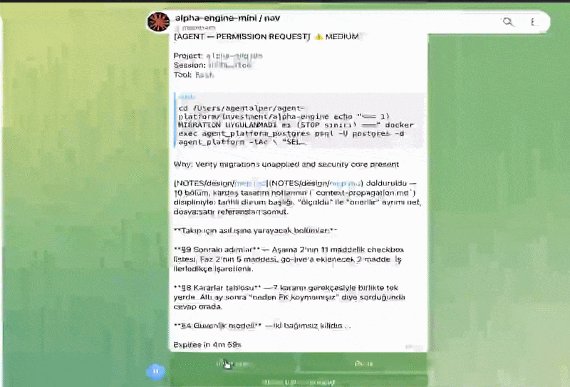

<p align="center">
  
</p>

# Halyard Fleet

[](https://github.com/alperarabaci/halyard-fleet/actions/workflows/ci.yml)
[](LICENSE)
[](https://www.python.org/downloads/)

Halyard Fleet runs your coding agents from your phone — from approving one agent's
commands to running a team of them through your project's own workflow.

**Start with one agent.** When Claude Code, Codex, opencode or ZCode wants to run
something, you see the command, the project it came from, and how risky it is — then you
allow or deny from Telegram. You send it new instructions and read its replies in the
same chat. And when a turn dies on a server error the desk would otherwise swallow — an
overloaded model, a usage limit hit mid-run — that reaches you too, instead of the
session just going quiet.

**Grow it into a team.** A navigator that plans, a driver that builds, a reviewer on
another family of model — each in a group of its own. The work goes from one to the
next the way your project writes it down: its own prompt in front, its tests and its
inspections run on the way, and each agent's last line deciding whether the work goes
forward, comes back, or waits for you.

It runs on your own machine. No open ports, no exposed API, nothing to log into.

Nothing is approved by accident: every failure — a crash, a timeout, an unreachable
control plane — denies. Three things can go through without a person, all off until you
turn them on: writes to paths you named, tools you named, and shell commands the gate
understands whole inside the project — reads, and the test and lint commands a project
trusts. Every one is written to the audit log with what allowed it, and one the log
cannot take is not let through.

**Runtimes:** Claude Code, Codex, opencode, ZCode &nbsp;·&nbsp; **Channel:** Telegram &nbsp;·&nbsp; **Tested on:** macOS


<p align="center">
  
</p>


## Why it exists

Remote desktops, terminal streaming and mobile IDEs all try to move *the machine* to
your phone. Halyard moves *the decisions* instead.

> The user should not operate the computer remotely.
> The user should manage the agent's decisions, direction, state, and coordination.

You are not typing commands on a phone. You are answering the questions your agents
would otherwise be blocked on, from wherever you are. And the more of the work they
hand each other, the more of what reaches you is worth a person: whether a plan is
right, whether the work goes back, whether it is done.

**If a job is not easier with Halyard, Halyard does not do it.**

## From one agent to a team

Each step adds one thing to the one before, and each has a [sample](samples/) you can
run as it is — a project small enough to read in a minute.

| Step | What it adds | From your phone | Sample |
|---|---|---|---|
| **Approve** | The agent's commands, edits and MCP calls as cards: what, where, how risky | Allow or Deny | [01](samples/01-one-agent/) |
| **Steer** | Its replies in the group, your messages into its session; agents on two runtimes, each in a group of its own | Type; `/prompts`; `/model`, `/effort`; `/stop` | [01](samples/01-one-agent/), [02](samples/02-two-agents/) |
| **Run the project's commands** | Its own tests and scripts, run by Halyard in the project — no agent, no card; a commit message to approve | `/command`; `/commit`; `/label` | [05](samples/05-the-whole-mechanism/) |
| **Fewer cards** | What you approve every time, trusted: test runs, notes. Proposed from your own log, chosen by you | — | [05](samples/05-the-whole-mechanism/), [09](samples/09-fewer-cards/) |
| **Hand over** | A navigator that plans and a driver that builds | `/forward`, `/to` | [03](samples/03-handing-work-over/) |
| **Inspect** | The project's own review of a reply: text you write, run as a read-only turn on the model you choose | `/inspect` | [04](samples/04-inspections/) |
| **Transitions** | The work taken to its next stage: the project's prompt in front, its commands and inspections run first | `/transition` | [06](samples/06-transitions/) |
| **Workflows** | Transitions as steps, each reply's last line deciding the next: forward, back, wait for you, done | `/workflow` | [07](samples/07-a-workflow/), [08](samples/08-three-agents/) |
| **Measure** | Every inspection run kept: repeated on another model, compared with what it cost | — | [10](samples/10-measuring-inspections/) |

A dash is work done once, at the desk: `halyard upkeep runs-advice` proposes what to
trust, and `halyard inspect` and `halyard usage` read back what the inspections found
and cost.

### A team, in one file

Agents, transitions and a workflow are a few lines under the project in
`halyard.yaml`. This is the shape of [sample 07](samples/07-a-workflow/), with the
driver on Codex and a second inspection on GPT:

```yaml
projects:
  cart:
    path: ~/code/cart
    commands:
      test-fast: python3 -m unittest -q
    inspections:
      test-reliability: {file: inspections/test-reliability.md, model: opus, effort: high}
      over-engineering: {file: inspections/over-engineering.md, model: gpt-6.1-sol, effort: high}
    transitions:
      develop: {prompt: transitions/develop.md, to: driver}
      developed: {prompt: transitions/developed.md, commands: [test-fast], to: navigator}
      close:
        prompt: transitions/close.md
        commands: [test-fast]
        inspect: [test-reliability, over-engineering]
        to: navigator
    workflows:
      steps:
        develop: {agent: cart-drv, rounds: 2}
        developed: {agent: cart-nav, rounds: 2}
        close: {agent: cart-nav, works_on: develop}
      deliver: [develop, developed, close]
    agents:
      cart-nav: {runtime: claude-code, session: cart-nav, role: navigator, chat: "-1001234567890"}
      cart-drv: {runtime: codex, session: cart-drv, role: driver, chat: "-1002234567890"}
```

From your phone, `/workflow` in the navigator's group, then **deliver**, then its first
step, **develop**:

- **develop** — the navigator's plan goes to the driver, with `develop.md` in front.
- **developed** — the driver's report comes back to the navigator, with the tests run
  first and their result beside it.
- **close** — the tests again, then both inspections, each on its own model; the
  navigator reads all of it, and closes the work or sends it back to the driver.

Each reply ends on a line such as `DECISION: forward`. `back` sends the work a step
back, `wait` stops the run until you send it on, and at the last step only `done` ends
it. A reply with none stops the run rather than hand an agent something not meant for
it, and `rounds: 2` lets a step go twice: a third time is yours to send. Every step is
told the words it decides in, so the project's prompts only have to ask for the line.

`halyard runs` reads back what each run did, step by step, with what each answer
decided. A plan in parts, each going through the same steps, and a reviewer whose
verdict the navigator acts on are in [Workflows](docs/workflows.md) and
[sample 08](samples/08-three-agents/).

## Quick start

### 1. Create a Telegram bot

Message [@BotFather](https://t.me/BotFather), send `/newbot`, and keep the token it
gives you. Then message [@userinfobot](https://t.me/userinfobot) to get your own user
id — only ids you list can approve anything.

Create a group for each agent you want to keep separate, and add the bot to each. One
bot covers every group.

### 2. Install

```bash
git clone https://github.com/alperarabaci/halyard-fleet.git
cd halyard-fleet
uv sync --extra dev
```

Requires Python 3.12+ and [uv](https://docs.astral.sh/uv/). It runs on the host, not
in a container — it needs the agent CLIs and their credentials.

### 3. Set it up and run

```bash
uv run halyard init      # asks what you have, writes halyard.yaml, wires it, checks it
uv run halyard           # keep this running
```

`init` asks how many agents you have of each runtime, offers the session names it can
already see, and reads the bot token without echoing it. It backs up any file it
replaces and keeps settings it does not manage.

Writing the file by hand instead, start from `halyard.simple.yaml.example` — one
project, one agent, one chat — and take anything more from `halyard.yaml.example`,
which describes all of it. Or start from a sample: `halyard samples add` puts its
project into your file and keeps everything already there.

One file describes a machine: the settings and the agents of every project it
gates. `halyard.yaml` is gitignored, and a real environment variable still
overrides it — so a container can pass a token in without writing it to disk.

> **A wired project depends on this process.** With Halyard down, a Bash command in
> that project is *denied* — all of them — and there is no terminal prompt to approve
> it with. opencode is the exception: its question waits on its own screen for
> whoever is at the desk. `halyard unwire <path>` hands the project back.
> [The rest of what to expect](docs/before-you-wire-it.md) is worth five minutes
> before you walk away from the machine.

Check it any time with `uv run halyard doctor`, and prove the gate actually stops
things with `uv run halyard verify` — which runs real commands into it rather than
reading configuration.

## Samples

Tiny projects to run under Halyard as they are — a page or a script, the
`halyard.yaml` it needs and the prompts it uses — from one agent up to three.
[All of them](samples/), one idea at a time:

1. [One agent](samples/01-one-agent/) — its commands as cards on your phone, its replies, a commit
2. [Two agents, two runtimes](samples/02-two-agents/) — Claude Code and Codex, each in its own chat, and a project command
3. [Handing work over](samples/03-handing-work-over/) — a navigator and a driver; `/forward`, `/to` and a transition
4. [Inspections](samples/04-inspections/) — the work inspected before it is handed on
5. [The whole mechanism](samples/05-the-whole-mechanism/) — commands, trusted runs, task labels
6. [Transitions](samples/06-transitions/) — work handed there and back with `/transition`, the tests run on the way
7. [A workflow](samples/07-a-workflow/) — the same transitions as steps, each reply deciding what comes next
8. [Three agents](samples/08-three-agents/) — Claude and GPT on one workflow with phases, two bounded contexts kept apart by a guard
9. [Fewer cards](samples/09-fewer-cards/) — what the project trusts, proposed from the cards it still asks, and the notes let through
10. [Measuring inspections](samples/10-measuring-inspections/) — every run kept, the same input on another model, and what each cost

## Runtimes

Each runtime brings its approvals to your phone and its replies with them. They differ
in where the gate lives and in what a message from the phone needs. `halyard wire`
writes the gate, and `halyard doctor` says what is still missing.

| Runtime | The gate | A message from the phone |
|---|---|---|
| Claude Code | hooks in `.claude/settings.local.json` | resumes the session |
| Codex | hooks in `.codex/hooks.json`, trusted once in Codex | resumes the thread |
| opencode | a plugin in `.opencode/plugins/`, and `permission` in `opencode.json`; opencode started with `--port 4096` | goes into the opencode that is open |
| ZCode | hooks in `.zcode/config.json`, trusted once in ZCode | needs `ZCODE_TOKEN` and `ZCODE_MODEL` in `halyard.yaml`; without them the agent takes its messages at the desk |

Codex and ZCode skip hooks nobody has trusted, without a word; `halyard wire` says how
to trust them, and never does it itself. opencode's question is on its
own screen as well as your phone: either can answer, and the first answer wins. A ZCode
turn stops at a captcha — see [Known limitations](#known-limitations).

## Commands

| In Telegram | |
|---|---|
| *(type anything)*, `/chat` | send it into that group's session |
| `/prompts` | your prompts — `/md` and any others — as buttons, each sent into the session when pressed |
| `/md` | *(configurable)* have the agent write its answer to a file and pass the path |
| `/stop` | end what is running here: a project command (a transition's or `/command`'s), and the turn in this chat's agent session with the cards it left open — for Claude Code and Codex, a turn sent from Halyard |
| `/options` | every model and effort level the runtime accepts |
| `/model`, `/effort` | what answers, and how hard it thinks |
| `/command` | run one of the project's own commands, and hear how it went |
| `/commit` | commit this branch's work, with a message to approve — and push |
| `/review_and_commit` | the same, plus this project's own validation and its review round |
| `/label` | put a label on the task this branch is for |
| `/forward` | hand this chat's last reply to another agent |
| `/to` | *(typed; not on the menu)* hand a message to another agent by name |
| `/inspect` | pick one of this project's own inspections and run it over the chat's last reply; the answer has a button per agent to hand it on |
| `/transition` | take the chat's last reply to its next stage, the way this project defines it — its own prompt in front, its commands and inspections run first |
| `/workflow` | take this project's transitions in the order it wrote them down, each reply's last line deciding the next step |
| `/status` | what each agent is, what is running, and how full its limits are — and this group's id, and whose it is |
| `/doctor` | the same check as `halyard doctor`, read from a phone |
| `/open` | open an app on the machine — `claude`, `codex`, `gemini` — with no card |
| `/pause`, `/resume` | step out of the way, and come back |
| `/actions`, `/agent` | status, pause, resume and stop — or options, model and effort — as buttons |
| `/help` | every command, and your prompts |

`TELEGRAM_MENU: simple` shows a short menu — `/actions`, `/stop`, `/agent`, `/prompts`,
`/commit`, `/open`, `/doctor` and `/help` — with the rest a card away; the full one,
every command and prompt, is the default. Every command answers when typed either way,
and `/help` lists them all. `halyard init` and the examples start on the short one.

`/md` is one of the `prompts:` in `halyard.yaml` — a sentence you say often
enough to want a name for. Each key there becomes a command. It exists because
a phone is bad at moving text: a long answer arrives split into three messages,
and handing it on means copying each piece while the agent receiving them
starts working on a third of the instruction. Better not to move it at all.

When Claude Code asks a **multiple-choice question** (its `AskUserQuestion`
tool), the options arrive on your phone as buttons — tap one, or reply with your
own answer. The choice goes straight back into the session, and the picker at
the desk never appears. Nobody answers in time, or Halyard is paused, and it
falls back to that picker rather than deciding for you. Claude Code only for now.

| On the machine | |
|---|---|
| `halyard init` | guided setup: `halyard.yaml`, wiring, and a check |
| `halyard samples add` | put a [sample](samples/)'s projects into `halyard.yaml`, keeping a backup |
| `halyard doctor` | what is wired, where, and what is broken |
| `halyard verify` | prove the gate stops things, by running into it |
| `halyard wire` / `unwire` | put the gate on a project, or take it off |
| `halyard sessions` | session names this machine can see |
| `halyard rules` | the commands each project trusts to run without asking; add, export, import |
| `halyard upkeep` | jobs Halyard does about itself — `runs-advice`: what a project could trust, from the cards it still asks; `recent` and `show` read past runs back |
| `halyard runs` | what workflow runs did: the latest, or one work's steps and decisions |
| `halyard inspect` | the inspection runs Halyard kept: `recent`, `repeat` one on another model, `compare` them side by side |
| `halyard usage` | what the turns Halyard started itself used, by model and purpose |
| `halyard export` | everything Halyard keeps — `halyard.yaml`, the database, the audit log, prompts, kept inspections, logs, and the files your projects' configuration points at (transition prompts, inspections) — in one dated zip under `export/`, readable by you only; it holds your bot token |
| `halyard service install` | run it as a launchd service (macOS) that updates itself first |

`halyard service install` sets up a launchd agent that comes back after a crash
and after a reboot. Every time it starts it runs `git pull --ff-only`, then
`uv sync --inexact`, then serves — so the machine you leave running stays
current without you logging in to update it, and a checkout you also develop in
keeps the tools `uv sync --extra dev` installed. The pull is fail-open: it never
rewinds or touches local changes, and a pull it cannot fast-forward is skipped
so the last known-good code still serves. It runs the code it pulls, so point
the branch at a remote you control; `install` prints which one. `uninstall` and
`status` do what they say. macOS only — on Linux, run `halyard serve` under a
systemd unit.

## What goes through without a card

Three grants, each off until you turn it on, each written to the audit log with what
allowed it.

**The commands a project trusts.** With `HALYARD_ALLOW_RISK_AT_OR_BELOW: low`, a shell
command the gate understands whole inside the project goes through: plain reads —
`cat`, `grep`, `git log` — and the commands the project names under `runs:`, or adds
with `halyard rules add`, written as the agent types them:

```yaml
projects:
  alpha-engine:
    runs:
      - make test-fast
      - uv run pytest *               # a last `*`: options and paths inside the project
```

An entry that could run anything — `bash *`, `python3 -c *`, `make *` — is refused. Not
sure what to trust? `halyard upkeep runs-advice <project>` reads the cards the project
still asks, has a model propose entries, and shows how many cards each would have
spared, counted from the log, with the `halyard rules add` line beside it. You add the
ones you agree with — [sample 09](samples/09-fewer-cards/), and
[Upkeep](docs/upkeep.md).

**Files the agent writes.** A turn you start from the phone runs headless, where Claude
Code cannot open its own permission dialog — so an unlisted `Write` used to be denied
outright, with nothing to answer and no sign of why. Now it asks. Name the places that
should not have to ask, at the top of `halyard.yaml`:

```yaml
writes:
  - NOTES/**
```

Patterns are matched *inside the project the write belongs to* — a path that climbs out
with `..` or through a symlink is refused however it is spelled. The gate's own files
always ask, whatever the pattern: `.git/` and the directories the runtimes read their
hooks from, so even `**` cannot let an agent switch the gate off. opencode's edits are
matched the same way, and a change to several files at once goes through only when
every one of them may.

**MCP calls and web fetches** are gated the same way, and for the same reason: at the
desk they are a popup, and from a phone they were denied with nothing to answer. An MCP
server is mostly read-only queries that one turn calls dozens of times, so name those
rather than approving each:

```yaml
tools:
  - mcp__*__list_*
  - mcp__*__get_*
```

One pattern covers the same tool on a local server and a production one. `Bash` and the
file tools cannot be granted here — the first is what the gate is for, and the second is
granted by destination under `writes:`.

## A project's own setup

**Commands, labels and commits** are one line each under the project in
`halyard.yaml`:

```yaml
projects:
  alpha-engine:
    path: ~/code/alpha-engine
    commands:                         # what /command offers, by name
      test-all: make test-all
      test-fast: make test-fast
      bootstrap: make bootstrap-up
    validate: test-fast               # one of commands:, run first by /review_and_commit
    labels:                           # everything about task labels
      offer: [andon, rework]          # narrows /label; empty means all of them
      exclude: [wontfix]              # never offered by /label, as patterns
    warn_if: [task-id-missing]        # the default; [] turns the warnings off
    confirmation:                     # the extra round, when a guard cannot catch it
      inquiry: NOTES/CONFIRMATION_INQUIRY.md
      review: NOTES/CONFIRMATION_REVIEW.md
```

`/command` runs in the background and reports the tail when it finishes, one at a time
per project. Exit 0 is passed and any other code failed, unless the command lists it
under `not_run:` — a transition stops at a command that did not run, rather than hand on
a result that is not there. In a transition, a command's last line is the one shown and
the only one its inspections read, so a command that ends on its own verdict reads
better than one that ends on `make: *** … Error 1`. `/label` reads the task number off
the branch and asks its issue tracker — `HALYARD_FORGE_TOKEN` is the only thing it
needs, and only a host that cannot name itself needs `forge:` as well.

`/commit` takes the whole working tree, has a message written for it in this
repository's own style, and shows what changed rather than only which files — and
stops there, which is what most changes want. `/review_and_commit` is the same command
with everything the project asked for: the command `validate:` names runs, the warnings
apply, and the round is offered. A failing one means no card at all.

**`confirmation:` buys a round that a guard cannot.** A test proves what it tests and a
file of invariants proves nothing at all — an agent's attention is finite, and past a
point more written rules are noise competing with the work. So the commit card offers a
third answer beside committing and not committing: send the round. `inquiry` is put in
front of the model while it writes the message and asks it one more thing — is *this*
change worth another look? — and any flag it raises is lifted out of the message and
shown above the card. `review` is the round itself, and goes to the project's navigator
when the button is pressed; nothing is committed, and committing afterwards is a fresh
`/commit` that reads the branch again. Both files belong to the project, because what
is worth asking again is something a team learns about its own failures.

**Inspections and transitions** have [a page of their own](docs/transitions.md), and
**workflows** [another](docs/workflows.md).

**When a session is compacted**, half its context goes and what it loses is the
expensive half: which numbers were measured rather than claimed, what you already
rejected and why, the corrections it made to its own earlier mistakes. What comes back
is a confident agent working from a slightly older version of events.

Two files per agent close that, and neither needs you to be watching:

```yaml
agents:
  nav:
    runtime: claude-code
    before_compaction: compaction_hook/precompact.md
    after_compaction: compaction_hook/postcompact.md
```

`before_compaction` is instructions for a record Halyard writes *about* the session as
it is compacted — a separate one-shot turn reads the transcript, so the live session is
never resumed or forked. `after_compaction` is what the session is handed once the
summary is done. Both are optional and per agent: a navigator holding a plan needs them,
a driver running one command does not.

Measured before it was built: a hook cannot steer the summary itself — output from
`PreCompact` is refused by the runtime as an injection attempt — and `SessionStart`
after a compaction is the one channel that reaches the model. The whole path is best
effort, so a record that is late or a file that is missing costs orientation, never the
session.

**The models Halyard's own turns run on** are settings. The compaction record is
written on `HALYARD_DEFAULT_MODEL` at `HALYARD_DEFAULT_EFFORT` — sonnet at the runtime's
own effort unless set — and `HALYARD_COMPACTION_MODEL` and `HALYARD_COMPACTION_EFFORT`
override it. Commit wording has its own pair, `HALYARD_COMMIT_MODEL` and
`HALYARD_COMMIT_EFFORT`; each unset field inherits its `HALYARD_DEFAULT_*`
counterpart. A small model can write commit messages while inspections and compaction
keep their choices:

```yaml
settings:
  HALYARD_COMMIT_MODEL: gpt-6-luna
  HALYARD_COMMIT_EFFORT: low
```

A `gpt-…` model runs on Codex. These settings are read when the service starts, and
`halyard doctor` checks the chosen models and efforts against the installed runtime's
catalog. Usage is recorded under `commit message`, `compaction record`, or the
inspection's name, so `halyard usage` can compare the measured tokens after a change.

## Known limitations

- **The desktop apps show an injected turn late, not never.** A message from your
  phone reaches the session and its reply comes back to you. In the Claude Code
  app, Reload shows it, without interrupting a turn that is running.
- **Two things can outrun the gate.** A hook that exceeds its timeout, and a wrapper
  that cannot start at all, both let the command through. `doctor` checks for the
  second.
- **A ZCode agent stops at a captcha.** Messages reach a ZCode session and its gate
  answers from your phone, but its provider asks for a captcha from time to time,
  and the token a solved one produces can only be got in ZCode's own window.
  Halyard says so and ends the turn rather than waiting on it; you solve it at the
  desk and send again. If you would rather not meet that at all, drive the agent
  with another runtime — opencode runs the same models and is gated the same way.
- **One bot token per machine.** Telegram's `getUpdates` has a single consumer.
- **`/commit` reads the whole working tree, not the staging area.** Agents write
  code and stage nothing, so a control plane that answered "nothing is staged"
  would be refusing the only thing it was asked for. What `.gitignore` excludes
  is excluded, and the card names the files that are new.
- **The project's own validation belongs to `/review_and_commit`, not `/commit`.**
  `validate:` names one of the project's `commands:` — `test-fast` — and it runs
  there; a failing one means no card at all rather than a question nobody can
  usefully answer. Plain `/commit` writes a message and stops, which is what
  most changes want.
- **Agents can be stopped from committing at all.** `HALYARD_REFUSE_AGENT_COMMITS`
  refuses an agent's own `git commit` or `git push` before anybody is asked. Off
  by default. Unlike everything else the gate does, `/pause` does not lift it: a
  pause means "stop asking me", and a guard a pause switches off is a guard
  nobody can rely on.
- **`/pause` steps aside rather than denying.** The runtime's own permission list
  then decides, with no card and no audit entry.
- **A chat that approves for itself is left to it.** Codex's "approve for me" and
  Claude Code's auto mode were chosen in the chat, so their calls are not asked
  again on the phone: the runtime's own reviewer decides, and the audit log says
  `call.left_to_agent`. Refusals such as `HALYARD_REFUSE_AGENT_COMMITS` still
  apply, and Halyard's own turns are always asked. `HALYARD_OVERRIDE_AGENT_APPROVALS:
  true` puts every call back on the gate; `halyard doctor` says which way it is.
- **The gate covers what the matcher covers** — Bash, the file tools, the
  question tool, MCP calls, `WebFetch` and `WebSearch`. Not `Read`, `Grep` or
  the client's own tool loading, which fire too and would put a card in front of
  every file read. Widening it also widens what stops when Halyard is down:
  those tools are denied then, exactly as Bash is.
- **Multiple-choice questions reach you from a desktop or terminal session, not from a
  turn you started over Telegram.** A Telegram-initiated turn runs headless, where
  Claude Code does not load `AskUserQuestion` — so it asks in prose you can just reply
  to, rather than as buttons.
- **Only Codex says how full its limits are.** It writes its accounting into its
  own transcript on every turn, so `/status` can read it back. Claude Code
  publishes nothing to read — measured on 2.1.246: no usage command on the CLI,
  and per-turn token counts with no limit anywhere among them — so its agents show
  no standing rather than a guess.
- **Nothing reports when the control plane's own token expires.** `claude auth
  status` answers with eight fields and not one of them is a date, and the token
  itself is opaque. So Halyard notes when it first saw the token and says so a
  month before the year is up, in words that admit it is an estimate. Minting a
  replacement starts the clock again on its own; the token is never written down,
  only a salted derivation of it.
- **Only macOS has been run.** Nothing here is deliberately macOS-only and the
  Linux paths exist, but they have not been exercised: the CLIs are found by
  looking in places a Mac keeps them, and holding the machine awake uses
  `caffeinate`, which simply does nothing elsewhere. Windows is untried
  entirely. If you run it somewhere else, `halyard doctor` is the first thing
  to read and the place a wrong assumption will show up.
- **Antigravity is not shipped.** The adapter works — it gates, it delivers, it
  brings replies back — but a command approved from your phone is still approved a
  second time in the desktop app whenever the agent asks to leave the sandbox.
  Antigravity ignores a hook that tries to grant that, deliberately: honouring it
  would let whoever controls the hook run unsandboxed code on the machine. That is
  the right call, so the runtime waits rather than shipping with a second prompt.
  Everything found along the way is written down in the notes below.

## What this is not

Out of scope, and not arriving later without a stated reason: remote desktop or terminal
streaming, automatic `allow all`, letting a model decide permissions on your behalf,
uncontrolled agent-to-agent messaging, or multi-user RBAC. Agents hand each other work
when you do — `/forward`, `/to` — or the way a project's own transitions and workflows
say, and a model's advice on what to trust is added by a person or not at all.

## Documentation

| | |
|---|---|
| [Samples](samples/) | Ten small projects, from one agent to a team, each run as it is |
| [Before you wire it in](docs/before-you-wire-it.md) | What changes, and what surprised us |
| [When it does not work](docs/when-it-does-not-work.md) | Every way setup has gone wrong so far, and the fix |
| [Setup](docs/setup.md) | Installing it, agents in YAML, gating a project by hand |
| [Inspections and transitions](docs/transitions.md) | A project's own inspections, and taking the work from one stage to the next |
| [Workflows](docs/workflows.md) | A project's transitions taken in order, each reply's last line deciding what comes next |
| [Telegram](docs/telegram.md) | The bot, agents, models and effort |
| [Upkeep](docs/upkeep.md) | Jobs Halyard does about itself: which commands a project could trust, from its log |
| [Architecture](docs/architecture.md) | How the layers fit, and the security posture |
| [Hook behaviour](docs/hook-payload-notes.md) | What the runtimes' hooks actually do — measured |
| [Session I/O](docs/session-io-notes.md) | Writing into a live session, and what forks it |
| [Antigravity notes](docs/antigravity-payload-notes.md) | A third runtime, measured in full and not shipped — and why |
| [ZCode notes](docs/zcode-payload-notes.md) | ZCode's hooks, measured — and the workspace trust its own guide says it lacks |

## Development

```bash
uv run pytest
uv run ruff check .
```

## License

[MIT](LICENSE) © alper arabaci
